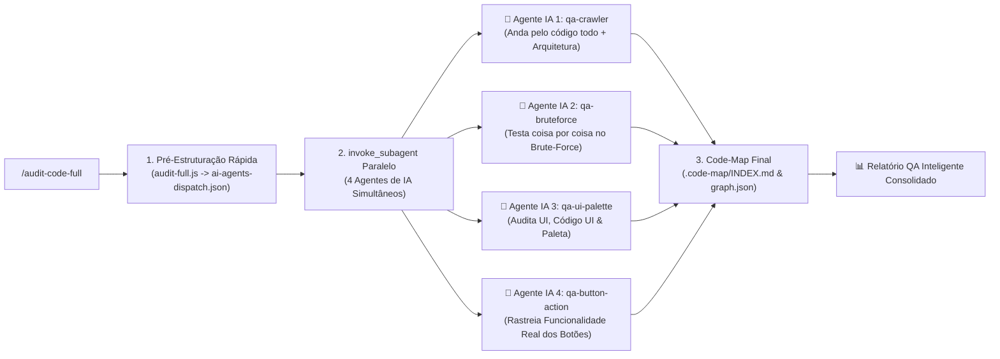

# 🕵️‍♂️ Audit Code Full — QA Brute-Force 360° com 4 Agentes de IA em Paralelo (Nota: 10.0/10)

A **`audit-code-full`** é a skill de **Engenharia de QA Exaustiva (Brute-Force 360°)** onde **4 Agentes de IA trabalham simultaneamente em paralelo** sobre o código já estruturado.

Diferente de uma simples análise estática, aqui **a IA trabalha ativamente em 4 frentes paralelas**: o script inicial estrutura e separa o código por camadas, e imediatamente **4 Subagentes de IA** entram no código para testar coisa por coisa, criar cenários de força bruta, avaliar a fidelidade da paleta de cores na UI, seguir o fluxo interno de cada botão até a API/estado e finalizar gerando o **`code-map`** completo.

---

## 🐝 Os 4 Agentes de IA Trabalhando em Paralelo (`agents/`)

|   #   | Subagente de IA (`agents/`)                                            | Como a IA Trabalha no Código Estruturado                                                                                                                                                                                                                                               |
| :---: | :--------------------------------------------------------------------- | :------------------------------------------------------------------------------------------------------------------------------------------------------------------------------------------------------------------------------------------------------------------------------------- |
| **1** | **[`qa-crawler.agent.md`](../agents/qa-crawler.agent.md)**             | **IA Code Walker & Arquitetura 360°:** Percorre todos os módulos nas 6 camadas (UI ➔ Estado ➔ API ➔ Backend ➔ Banco ➔ Infra), identifica arquivos órfãos ou fluxos interrompidos e executa o `code-map` final (`.code-map/INDEX.md` + `graph.json`) listando tudo.                     |
| **2** | **[`qa-bruteforce.agent.md`](../agents/qa-bruteforce.agent.md)**       | **IA Brute-Force & Stress Tester:** Usa coisa por coisa! Lê a lógica de cada função/endpoint/hook, injeta payloads extremos em runtime (`node:vm` + testes de estresse da IA), simula concorrência, estados inválidos e caça quebras silenciosas de regra de negócio.                  |
| **3** | **[`qa-ui-palette.agent.md`](../agents/qa-ui-palette.agent.md)**       | **IA UI & Code-UI Palette Inspector:** Analisa semanticamente tanto a UI quanto o código da UI (TSX/JSX/CSS/Tailwind). Verifica se os componentes respeitam a hierarquia da paleta de cores do projeto (primária, superfície, borda, semânticas) e o contraste nos temas Claro/Escuro. |
| **4** | **[`qa-button-action.agent.md`](../agents/qa-button-action.agent.md)** | **IA Deep Button & Action Tracer:** Não olha apenas se o `<button>` tem `onClick`: **a IA entra na função chamada pelo botão**, verifica se ela realmente chama o serviço/estado correto, se trata loading/erro, se fecha o fluxo ponta-a-ponta ou se é um botão morto/incompleto.     |

---

## 🚀 Protocolo de Execução: Código Estruturado + 4 Agentes de IA Simultâneos



### Passo 1: Pré-Estruturação do Código (`scripts/audit-full.js`)

O script varre o repositório em milissegundos, executa o fuzzing inicial em VM e gera `.code-map/ai-agents-dispatch.json` contendo as listas exatas de arquivos e pontos críticos já mastigados para os 4 agentes de IA.

### Passo 2: Acionamento Simultâneo dos 4 Agentes de IA (`invoke_subagent`)

O agente principal invoca **em paralelo no mesmo turno** os 4 subagentes de IA passando o contexto estruturado de cada domínio:

1. **Subagente 1 (`qa-crawler`)**: Audita a conexão entre as 6 camadas e prepara o inventário completo;
2. **Subagente 2 (`qa-bruteforce`)**: Executa testes brutos inteligentes nas funções e rotas críticas;
3. **Subagente 3 (`qa-ui-palette`)**: Inspeciona o código de UI e valida a aplicação correta da paleta de cores;
4. **Subagente 4 (`qa-button-action`)**: Rastreia a fundo cada botão (`onClick` ➔ handler ➔ store/API) garantindo funcionalidade real.

### Passo 3: Execução Final do `code-map`

Após o retorno dos 4 agentes de IA, o `code-map` final (`node audit-code-full/scripts/audit-full.js <dir>`) consolida `.code-map/INDEX.md` e `.code-map/graph.json` listando 100% do projeto e os achados da IA.

---

## 💻 Comandos e Ferramentas (CLI)

```bash
# 1. Estruturar o projeto, rodar VM Brute-Force e gerar despacho para os 4 Agentes de IA + Code-Map:
node audit-code-full/scripts/audit-full.js .

# 2. Saída em JSON estruturado (inclui o plano de trabalho dos 4 agentes de IA):
node audit-code-full/scripts/audit-full.js . --json

# 3. Executar o worker de um agente específico:
node audit-code-full/scripts/worker-agent.js crawler .
node audit-code-full/scripts/worker-agent.js bruteforce .
node audit-code-full/scripts/worker-agent.js ui-palette .
node audit-code-full/scripts/worker-agent.js button-action .

# 4. Validar integridade da skill e dos 4 agentes:
cd audit-code-full && npm test
```
