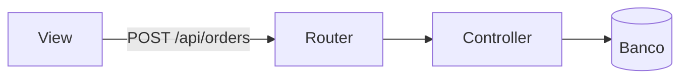

# Fases de Planejamento — Análise de Impacto, Sabatina Q1–Q4, Mapa Visual e Trava

> Referência carregada sob demanda pelo `SKILL.md` do Hybrid Orchestrator (Seção 3 original, movida na íntegra).

## 3. Fases de Planejamento (Rotas B e C — antes de qualquer código)

> **Rota C:** apenas análise de impacto + checklist. Sem sabatina completa e sem Mermaid. Trava só se risco for Médio/Alto ou houver ambiguidade.
> **Rota B:** planejamento completo (análise de impacto, sabatina Q1–Q4, mapa visual, checklist) e Trava sempre.

### 3.1 Análise de Impacto

Antes de propor qualquer alteração, consulte **`.code-map/INDEX.md`** (ou `.code-map/graph.json` / `.code-map/handshake.json`) e declare:

- **Arquivos afetados:** liste cada arquivo e se será criado, editado ou apenas lido.
- **Grafo de dependências:** consuma diretamente as conexões já mapeadas em `.code-map/INDEX.md` / `.code-map/graph.json` (ou `.code-map/handshake.json`) como evidência direta (`confirmed`), evitando buscas repetitivas no código. Para nós não listados no mapa, indique se foi **encontrado por busca no código** ou se é **suposição**.
- **Avaliação de risco:**
  - 🟢 **Baixo:** código novo e aditivo, sem impacto em contratos existentes.
  - 🟡 **Médio:** extensão de funcionalidade com poucas dependências afetadas.
  - 🔴 **Alto:** múltiplas telas ou serviços dependem diretamente do contrato alterado. Exige plano de reversão e Trava, mesmo na Rota C.

### 3.2 Sabatina de Requisitos em 4 Quadrantes *(Rota B apenas)*

O agente preenche cada quadrante com **suposições declaradas** a partir do contexto disponível. Pergunta ao usuário apenas o que **bloquearia a execução** se assumido errado — no máximo 2 perguntas (Regra 8). O restante é apresentado como suposição e pode ser corrigido na Trava.

| Quadrante | Alinhamentos — preencher com suposições ou confirmar |
| :--- | :--- |
| **Q1: Contratos de API & Tipagem** | Formato do payload (Body/Query/Params), status HTTP esperados, estrutura do JSON de saída, versão da rota. |
| **Q2: Dados, Concorrência & Transações** | Precisa de transação atômica? Há risco de race condition (saldo, estoque, filas)? Exige lock otimista (ex: version column) ou pessimista? Chave de idempotência (Idempotency-Key ou unique constraint) para duplo envio? A migração é estritamente aditiva? |
| **Q3: Estados de Interface (se houver UI)** | Como a tela se comporta em **Carregando**, **Erro**, **Vazio** e **Sucesso**? Quais componentes reutilizar? Se a skill `frontend-craftsman` estiver disponível, anexe o **DESIGN_SPEC.md** gerado com paleta (neutros + 1 accent), tipografia, molas Framer Motion e wireframe para validação visual prévia na Trava. |
| **Q4: Segurança & Permissões** | Rota pública ou privada? Exige autenticação, roles/RBAC, filtro por usuário/tenant? Algum dado sensível em log ou resposta? |

> Se algum quadrante não se aplicar, declare: *"Q3 não aplicável — demanda é backend-only."*

### 3.3 Mapa Visual

Apresente o plano de forma visual antes da Trava de Permissão:

**a) Árvore de arquivos (Antes → Depois):**
```text
projeto/
├── src/
│   ├── controllers/
│   │   ├── userController.ts      [INALTERADO]
│   │   └── orderController.ts     [CRIAR]
│   └── routes/
│       └── routes.ts              [EDITAR]
└── frontend/src/
    └── views/
        └── OrderView.tsx          [CRIAR]
```

**b) Fluxo de dados (Mermaid):**


**c) Wireframe ASCII (obrigatório se houver nova tela ou card):**
```text
┌──────────────────────────────────────┐
│ Título do Card                       │
│ [Valor Principal]       [Secundário] │
│ Subtítulo / Descrição                │
│ [Ação Principal]  [Ação Secundária]  │
└──────────────────────────────────────┘
```

**d) Checklist de tarefas numeradas:**
```text
[ ] Tarefa 1: [camada] descrição exata
[ ] Tarefa 2: [camada] descrição exata
[ ] Tarefa N: Executar verificação final (seção 7)
```

### 3.4 Trava de Permissão

> **🛑 TRAVA: O diagnóstico, a arquitetura e o plano acima atendem à sua necessidade?**
>
> Responda com (respostas equivalentes como "ok", "pode ir", "manda ver" também são aceitas):
> - **"OK - Executar Tudo"** → execução autônoma de todas as tarefas, incluindo o loop do Falsifier. **Não cobre migrações de banco:** cada migração exige confirmação separada antes de ser redigida.
> - **"OK - Passo a Passo"** → executa uma tarefa, para e aguarda validação antes de continuar.
> - **"Ajustes"** → descreva o que mudar; o planejamento é revisado antes de qualquer código.

🚨 **REGRA DE BLOQUEIO ABSOLUTO DO TURNO 1:**
- **Nenhum arquivo de código é modificado, criado ou deletado antes da resposta a esta trava.**
- **Pare de chamar ferramentas imediatamente** após apresentar esta mensagem no chat.
- Somente no Turno 2 (após o usuário enviar "OK", "pode ir", "manda ver"), inicie criando o snapshot git (`node scripts/snapshot.js --save`) e executando as tarefas do plano.

**Ambiente não interativo (background, CI, modo sem resposta do usuário):** entregar o plano e parar. Seguir adiante com as suposições declaradas apenas se o risco for Baixo.

**Mudança de escopo durante a execução** (arquivo novo surgiu, contrato difere do aprovado): pausar, declarar a divergência e exigir nova Trava antes de continuar.
